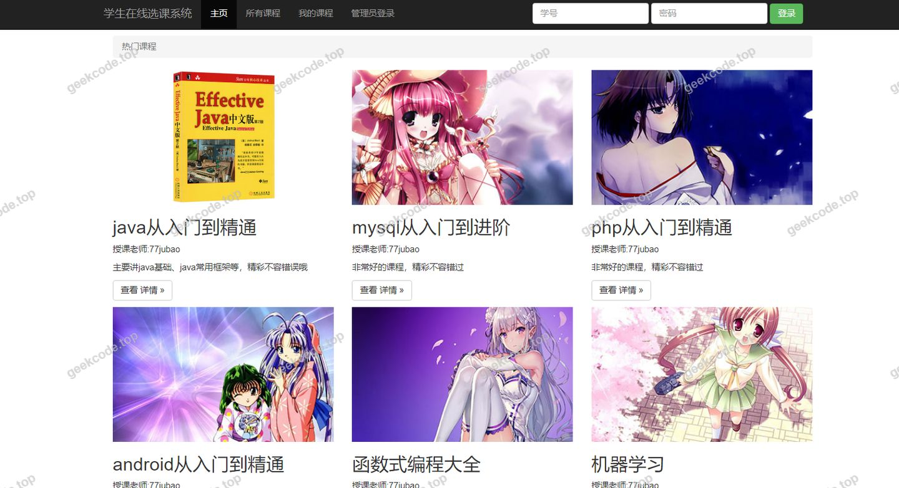
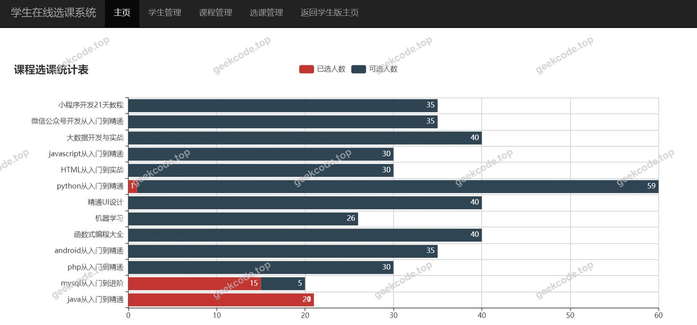
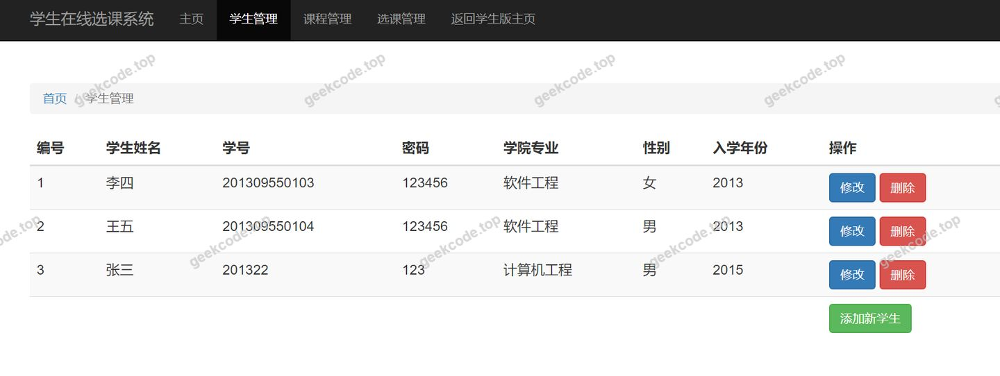
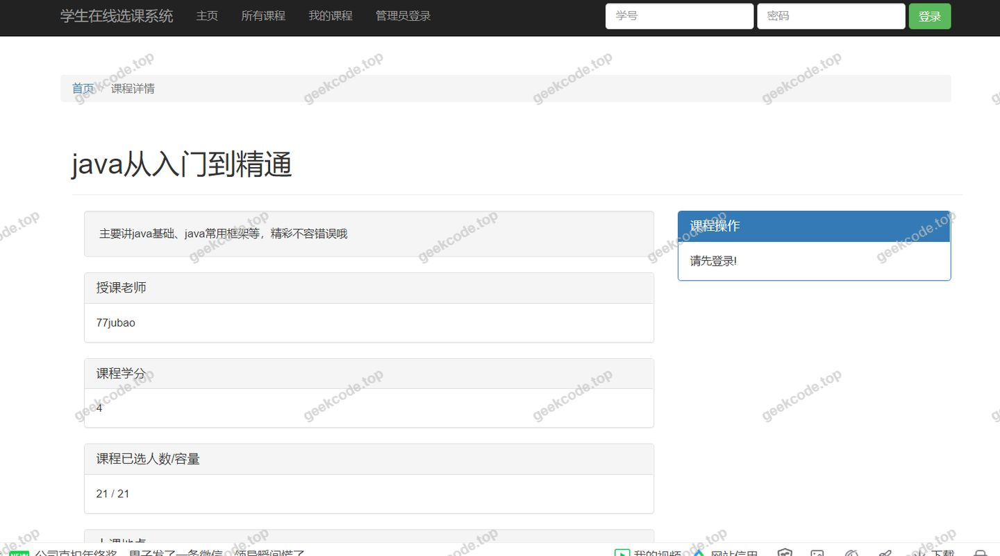

# java【毕业设计】精品项目-基于ssm的学生在线选课系统

> 🎓 **计算机毕业设计 · java【毕业设计】精品项目-基于ssm的学生在线选课系统**
>
> 本仓库只放**项目介绍 + 运行截图**（截图是站点带水印的原图，存在仓库 `images/` 里）。
>
> 👉 **完整可运行源码 / 数据库脚本 / 部署文档：[点我获取](https://geekcode.top/archives/java%E3%80%90%E6%AF%95%E4%B8%9A%E8%AE%BE%E8%AE%A1%E3%80%91%E7%B2%BE%E5%93%81%E9%A1%B9%E7%9B%AE-%E5%9F%BA%E4%BA%8Essm%E7%9A%84%E5%AD%A6%E7%94%9F%E5%9C%A8%E7%BA%BF%E9%80%89%E8%AF%BE%E7%B3%BB%E7%BB%9F?utm_source=github)**
>
> 💬 咨询微信：**ir9372**　|　🌐 更多项目：[极客代码 geekcode.top](https://geekcode.top/?utm_source=github)
>
> 📌 项目详情页：<https://geekcode.top/archives/java%E3%80%90%E6%AF%95%E4%B8%9A%E8%AE%BE%E8%AE%A1%E3%80%91%E7%B2%BE%E5%93%81%E9%A1%B9%E7%9B%AE-%E5%9F%BA%E4%BA%8Essm%E7%9A%84%E5%AD%A6%E7%94%9F%E5%9C%A8%E7%BA%BF%E9%80%89%E8%AF%BE%E7%B3%BB%E7%BB%9F?utm_source=github>

<table><td width="230" align="center"> <b>扫码加微信 ir9372</b></td><td valign="middle">📦 源码 = 项目介绍 + 全部运行截图 + 数据库 + 部署文档 👉 点上方任意截图，直接跳到 <b>极客代码 geekcode.top</b> 详情页</td></table>

---

<h1>java【毕业设计】精品项目-基于ssm的学生在线选课系统</h1>
<h2>项目概述</h2>

本项目为“基于 SSM 的学生在线选课系统”，旨在构建一个高效、稳定的学生课程管理平台。系统采用经典的 Java Web 技术栈，核心目标是通过数字化手段优化传统选课流程，解决人工管理效率低、数据易出错等问题。适用人群主要为高校教务管理人员及在校学生。技术架构上，后端基于 Spring、Spring MVC 和 MyBatis（SSM）框架搭建，前端采用 JSP 页面进行视图渲染，数据持久层使用 MySQL 数据库。尽管当前配置显示无独立的前后台路由菜单定义，但根据项目名称及截图所示的运行界面，系统具备基本的用户交互与业务处理能力，实现了从登录到选课的核心闭环逻辑，适用于中小型教育信息化场景。

<h2>技术架构</h2>

本系统采用分层架构设计，严格遵循 MVC 设计模式，确保代码的高内聚与低耦合。

<ol>
<li><strong>表现层（View）</strong>：使用 JSP（JavaServer Pages）作为前端视图技术，负责页面的动态渲染与用户交互数据的接收。</li>
<li><strong>控制层（Controller）</strong>：基于 Spring MVC 框架处理 HTTP 请求，通过注解映射 URL 到具体的业务方法，实现请求分发与响应返回。</li>
<li><strong>业务逻辑层（Service）</strong>：由 Spring Framework 提供依赖注入（IoC）和面向切面编程（AOP）支持，管理事务边界，协调各模块间的业务逻辑。</li>
<li><strong>数据访问层（DAO）</strong>：集成 MyBatis 框架，通过 XML 配置文件或注解将 SQL 语句与 Java 对象进行映射，简化 JDBC 操作，提高数据库交互效率。</li>
<li><strong>核心技术选型理由</strong>：</li>
</ol>
<ul>
<li><strong>Spring Context/Core/Web</strong>：提供企业级应用所需的基础设施，如 Bean 生命周期管理和 Web 容器集成。</li>
<li><strong>Spring TX/JDBC</strong>：保证数据一致性和连接池管理。</li>
<li><strong>MyBatis</strong>：相比 Hibernate，MyBatis 更灵活地控制 SQL 执行，适合需要精细查询优化的选课统计场景。</li>
<li><strong>JSP</strong>：作为服务端渲染技术，无需额外前端构建工具，部署简单，符合毕业设计快速交付的需求。</li>
</ul>
<h2>功能模块</h2>

根据提供的上下文信息，系统未明确列出详细的前台导航菜单、个人中心菜单或后台路由配置。因此，仅依据项目名称“学生在线选课系统”及通用 SSM 架构逻辑，梳理出以下基础功能模块。<strong>注意：由于缺乏具体菜单数据，以下模块描述基于系统名称推导，实际功能以源码运行结果为准。</strong>

<h3>1. 用户认证模块</h3>
<ul>
<li><strong>登录/注册</strong>：提供学生身份验证入口，校验账号密码合法性，建立会话状态。</li>
<li><strong>退出登录</strong>：安全销毁用户 Session，防止未授权访问。</li>
</ul>
<h3>2. 选课业务模块</h3>
<ul>
<li><strong>课程浏览</strong>：展示可选课程列表，包含课程名称、学分、授课教师等基本信息。</li>
<li><strong>课程选择</strong>：允许学生将特定课程添加至个人选课清单。</li>
<li><strong>已选课程查看</strong>：显示当前学生已选中的所有课程，支持查看详情。</li>
<li><strong>退课操作</strong>：在截止时间前允许学生移除已选课程。</li>
</ul>
<h3>3. 系统基础模块</h3>
<ul>
<li><strong>个人信息管理</strong>：修改学生基本资料（如联系方式）。</li>
<li><strong>通知公告</strong>：发布选课时间、规则变更等系统消息。</li>
</ul>

<em>(注：根据现有信息无法确定是否包含管理员后台的具体增删改查功能细节，上述模块主要侧重于学生端核心业务流程。)</em>

<h2>用户角色与权限</h2>

鉴于项目类型为“学生在线选课系统”且上下文未提及多角色复杂权限体系，通常此类系统至少包含以下角色。若存在隐藏的管理员接口，其权限如下：

<ol>
<li><strong>普通学生</strong></li>
</ol>
<ul>
<li><strong>可访问功能</strong>：登录系统、浏览公开课程列表、进行选课/退课操作、查看个人已选课程表、修改个人非敏感信息。</li>
<li><strong>权限限制</strong>：无法查看其他学生的选课数据，无法添加或删除课程库中的课程，无法发布全局公告。</li>
</ul>
<ol start="2">
<li><strong>教务管理员</strong>（假设存在，基于常规系统设计）</li>
</ol>
<ul>
<li><strong>可访问功能</strong>：所有学生权限，外加课程信息管理（新增、编辑、删除课程）、学生信息管理（导入、重置密码）、选课数据统计、公告发布。</li>
<li><strong>权限限制</strong>：通常不直接参与学生端的选课模拟操作，除非拥有测试权限。</li>
</ul>

<em>(说明：根据提供的“无前台导航菜单”、“无后台路由”等空值信息，具体的角色划分可能仅体现在代码内部的拦截器或过滤器中，而非显式的菜单结构。)</em>

<h2>项目特色与创新点</h2>
<ol>
<li><strong>经典稳健的技术组合</strong>：采用成熟的 SSM（Spring + Spring MVC + MyBatis）架构，该组合在 Java EE 领域具有极高的稳定性和广泛的社区支持，便于维护与扩展。</li>
<li><strong>轻量级部署方案</strong>：摒弃了复杂的前后端分离微服务架构，选用 JSP 服务端渲染，减少了前端构建步骤和跨域配置复杂度，适合单机或小规模集群部署，降低了运维成本。</li>
<li><strong>数据操作灵活性</strong>：利用 MyBatis 的动态 SQL 特性，能够高效处理复杂的选课查询条件（如按学期、按学院筛选），相比纯 ORM 框架在处理报表类查询时更具性能优势。</li>
<li><strong>专注核心业务逻辑</strong>：系统聚焦于“选课”这一高频并发场景，通过 Spring 的事务管理机制确保选课过程中库存扣减与记录写入的原子性，有效防止超选现象。</li>
</ol>
<h2>部署环境</h2>

为确保系统正常运行，需准备以下软硬件环境：

<ol>
<li><strong>操作系统</strong>：Windows 7/10/11, Linux (CentOS 7+, Ubuntu 18.04+), macOS。</li>
<li><strong>开发语言运行时</strong>：</li>
</ol>
<ul>
<li>JDK 1.8 或以上版本（推荐 JDK 1.8，兼容性好）。</li>
</ul>
<ol start="3">
<li><strong>Web 服务器/容器</strong>：</li>
</ol>
<ul>
<li>Apache Tomcat 8.5 或 9.0（JSP 运行必需）。</li>
</ul>
<ol start="4">
<li><strong>数据库</strong>：</li>
</ol>
<ul>
<li>MySQL 5.7 或 8.0（需创建对应数据库并导入初始化脚本）。</li>
</ul>
<ol start="5">
<li><strong>构建工具</strong>：</li>
</ol>
<ul>
<li>Maven 3.6+（用于依赖管理和项目打包）。</li>
<li>IDE：IntelliJ IDEA 或 Eclipse（需安装 Java EE 插件）。</li>
</ul>
<ol start="6">
<li><strong>浏览器</strong>：</li>
</ol>
<ul>
<li>Chrome, Firefox, Edge 等现代主流浏览器（建议禁用 IE 兼容性视图）。</li>
</ul>
<h2>五、技术特性</h2>
<ul>
<li>服务端模板渲染（JSP）</li>
</ul>
<h2>六、功能模块截图</h2>
<h3>前台用户端</h3>
<h4>系统运行界面1</h4>

<h4>系统运行界面2</h4>

<h4>系统运行界面3</h4>

<h4>系统运行界面4</h4>

---

## 获取完整源码

| 项目 | 说明 |
| --- | --- |
| 项目名 | java【毕业设计】精品项目-基于ssm的学生在线选课系统 |
| 运行截图 | 本文 4 张（站点带水印原图，仓库 `images/` 目录） |
| 完整源码 | [https://geekcode.top/archives/java%E3%80%90%E6%AF%95%E4%B8%9A%E8%AE%BE%E8%AE%A1%E3%80%91%E7%B2%BE%E5%93%81%E9%A1%B9%E7%9B%AE-%E5%9F%BA%E4%BA%8Essm%E7%9A%84%E5%AD%A6%E7%94%9F%E5%9C%A8%E7%BA%BF%E9%80%89%E8%AF%BE%E7%B3%BB%E7%BB%9F?utm_source=github](https://geekcode.top/archives/java%E3%80%90%E6%AF%95%E4%B8%9A%E8%AE%BE%E8%AE%A1%E3%80%91%E7%B2%BE%E5%93%81%E9%A1%B9%E7%9B%AE-%E5%9F%BA%E4%BA%8Essm%E7%9A%84%E5%AD%A6%E7%94%9F%E5%9C%A8%E7%BA%BF%E9%80%89%E8%AF%BE%E7%B3%BB%E7%BB%9F?utm_source=github) |
| 咨询微信 | **ir9372**（备注：jingpin-yuanma） |
| 更多项目 | [极客代码 geekcode.top](https://geekcode.top/?utm_source=github) |

> 需要源码、部署、改配置、跑不起来等问题，加微信 ir9372 沟通，说明项目名即可。
